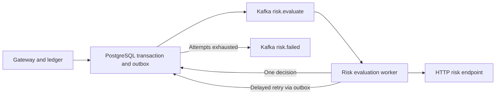

# Transaction Risk Integration Service


A Java 21 and Spring Boot integration service for two synthetic transaction feeds. PostgreSQL stores normalized transactions and a transactional outbox. Kafka delivers evaluation requests to a worker that calls a separate HTTP risk endpoint. Docker Compose runs all four services.

## Delivery and recovery



The API commits the intake row and its first outbox event together. The relay claims due rows with `FOR UPDATE SKIP LOCKED` and deletes a row only after Kafka acknowledges it. Kafka can deliver a message more than once. The consumer locks the transaction row and checks the expected attempt so repeated or stale events cannot create a second decision. A failed call schedules retries after one and two seconds by default. After three failed attempts, the worker writes an outbox event for `risk.failed`. The retry API can schedule a new cycle using the original transaction ID.

| Scenario | Behavior |
| --- | --- |
| Gateway sends integer minor units and ledger sends a decimal amount | Both adapters normalize to the same UUID, currency and minor-unit amount. |
| The same transaction arrives concurrently | The PostgreSQL primary key admits one record. Processing uses a row lock. |
| A UUID is reused with a different amount or currency | The API returns HTTP 409. |
| Risk service is unavailable | The worker persists the failed attempt and schedules a retry or emits a failure event. |
| Risk service becomes available | A scheduled retry can resume processing. The retry endpoint can replay an exhausted transaction. |

## Run locally

Requires Docker with Compose.

```sh
docker compose up --build -d
curl -s -X POST http://localhost:8080/transactions/gateway \
  -H 'Content-Type: application/json' \
  -d '{"id":"01aa8308-0480-4633-a99d-ea00f2c337bc","amountMinor":1250,"currency":"EUR"}'
curl -s -X POST http://localhost:8080/transactions/ledger \
  -H 'Content-Type: application/json' \
  -d '{"reference":"01aa8308-0480-4633-a99d-ea00f2c337bc","total":"12.50","ccy":"EUR"}'
```

Both responses refer to the same record. Intake may return HTTP 202 before the worker commits a decision. Use `GET /transactions/{id}` to inspect its status and confirm that its final attempt count is one.

## Diagnose and replay a failed transaction

Use a fresh UUID if the demo has already been run on the same database volume.

```sh
docker compose stop risk
curl -s -X POST http://localhost:8080/transactions/gateway \
  -H 'Content-Type: application/json' \
  -d '{"id":"6bcffb62-6758-4bdf-8f8a-4cf55f443a18","amountMinor":70000,"currency":"EUR"}'
curl -s http://localhost:8080/transactions/6bcffb62-6758-4bdf-8f8a-4cf55f443a18
docker compose logs app
```

Wait until the status endpoint reports `FAILED` with three attempts, then inspect the failure topic and replay:

```sh
docker compose exec kafka /opt/kafka/bin/kafka-console-consumer.sh --bootstrap-server kafka:9092 --topic risk.failed --from-beginning --timeout-ms 5000
docker compose start risk
curl -s -X POST http://localhost:8080/transactions/6bcffb62-6758-4bdf-8f8a-4cf55f443a18/retry
curl -s http://localhost:8080/transactions/6bcffb62-6758-4bdf-8f8a-4cf55f443a18
```

The transaction eventually reaches `DECIDED` with `REVIEW` on attempt four. The original synchronous mode is available with `RISK_ASYNC=false`.

## Test

```sh
mvn verify
```

The integration suite starts PostgreSQL and Kafka with Testcontainers and exercises the HTTP API against a controlled risk endpoint. It checks concurrent intake, duplicate Kafka delivery, automatic recovery after stopping and restarting the Kafka listener, and manual replay after a failure event. GitHub Actions runs the suite and validates the Compose file.

The service guarantees one committed decision per transaction UUID. An interruption after the remote request but before the database commit can cause a subsequent request to contact the risk service again. The API forwards the transaction UUID as an idempotency key. The synthetic risk service returns a deterministic decision and has no side effects.

