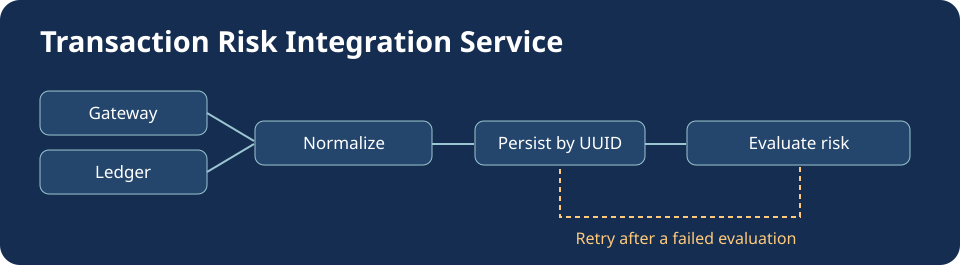

# Transaction Risk Integration Service



A Java 21 and Spring Boot service that integrates two synthetic transaction feeds with a separate HTTP risk endpoint. PostgreSQL stores the normalized transaction and its processing status. Docker Compose runs the API, database and synthetic risk service.

| Scenario | Behavior |
| --- | --- |
| Gateway sends integer minor units and ledger sends a decimal amount | Both adapters normalize to the same UUID, currency and minor-unit amount. |
| The same transaction arrives concurrently | The PostgreSQL primary key admits one record. Processing uses a row lock. |
| A UUID is reused with a different amount or currency | The API returns HTTP 409. |
| Risk service is unavailable | The API returns HTTP 202 and stores a failed attempt. |
| Risk service becomes available | Explicit retry evaluates the stored transaction and commits its decision. |

## Run locally

Requires Docker with Compose.

```sh
docker compose up --build -d
curl -s -X POST http://localhost:8080/transactions/gateway \
  -H 'Content-Type: application/json' \
  -d '{"id":"01aa8308-0480-4633-a99d-ea00f2c337bc","amountMinor":1250,"currency":"EUR"}'
curl -s -X POST http://localhost:8080/transactions/ledger \
  -H 'Content-Type: application/json' \
  -d '{"reference":"01aa8308-0480-4633-a99d-ea00f2c337bc","total":"12.50","ccy":"EUR"}'
```

Both responses refer to the same record and show one evaluation attempt once processing completes.

## Diagnose and replay a failed transaction

Use a fresh UUID if the demo has already been run on the same database volume.

```sh
docker compose stop risk
curl -s -X POST http://localhost:8080/transactions/gateway \
  -H 'Content-Type: application/json' \
  -d '{"id":"6bcffb62-6758-4bdf-8f8a-4cf55f443a18","amountMinor":70000,"currency":"EUR"}'
curl -s http://localhost:8080/transactions/6bcffb62-6758-4bdf-8f8a-4cf55f443a18
docker compose logs app
docker compose start risk
curl -s -X POST http://localhost:8080/transactions/6bcffb62-6758-4bdf-8f8a-4cf55f443a18/retry
```

The transaction transitions from `FAILED` on attempt 1 to `DECIDED` with `REVIEW` on attempt 2. The status endpoint also exposes records left pending if an application process stops after initial persistence.

## Test

```sh
mvn verify
```

The integration suite starts PostgreSQL with Testcontainers and exercises the real HTTP API against a controlled risk endpoint. It checks concurrent delivery through both adapters, conflicting duplicates, persistent failures, successful replay and repeated retry after a terminal state. GitHub Actions runs the same suite and validates the Compose file.

The service guarantees one committed decision per transaction UUID. An interruption after the remote request but before the database commit can cause a subsequent request to contact the risk service again. The API forwards the transaction UUID as an idempotency key. The synthetic risk service returns a deterministic decision and has no side effects.

